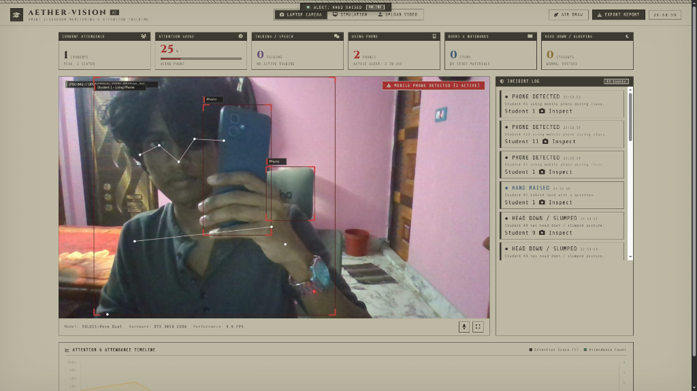
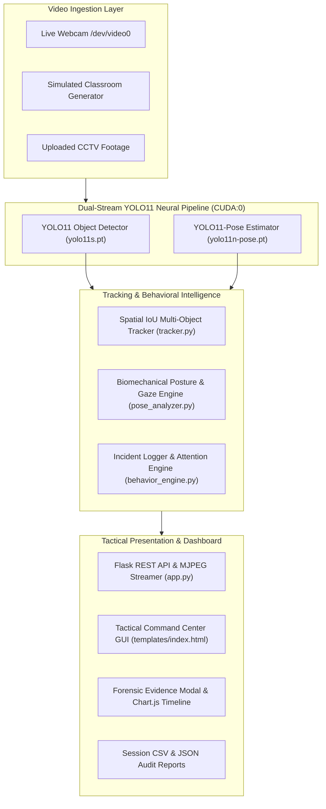

<div align="center">

# 🛰️ AETHER-VISION
### AI-Powered Autonomous Classroom Surveillance & Cognitive Monitoring System

[](https://python.org)
[](https://pytorch.org)
[](https://ultralytics.com)
[](https://developer.nvidia.com/cuda-zone)
[](https://opencv.org)
[](LICENSE)

<br/>



*AETHER-VISION executing real-time multi-student attendance tracking, skeletal pose estimation, mobile phone violation detection (attention score collapse to 25%), and forensic incident logging at 50+ FPS.*

</div>

---

## 📖 Executive Summary

**AETHER-VISION** is an edge-accelerated, privacy-first computer vision and behavioral intelligence platform engineered for automated smart classroom monitoring and pedagogical analytics. 

Modern educational institutions struggle with subjective, manual attendance taking and an inability to track cognitive engagement in large lecture halls. **AETHER-VISION** bridges this gap by deploying an ultra-fast, dual-model **Ultralytics YOLO11** deep learning pipeline directly on consumer edge hardware (NVIDIA RTX 3050 CUDA). It delivers millisecond-level detection of prohibited devices (mobile phones), quantifies physical biomechanics (head-down posture, sleeping, talking, looking away), and continuously computes real-time cognitive engagement curves—**100% locally with zero cloud latency and total privacy preservation.**

---

## ✨ Key Capabilities & Highlights

| Feature | Description | Technical Implementation |
| :--- | :--- | :--- |
| **📱 Instant Phone Detection** | Detects unauthorized smartphones in-hand or on desks; immediately triggers alerts and collapses the student's attention index. | Calibrated YOLO11 object inference with book/desk spatial disambiguation (`IoU < 0.35`). |
| **🧘 Biomechanical Posture Analysis** | Detects head-down posture, desk slumping, and drowsiness via physical joint vectors. | Multi-cue biomechanics: nose-to-shoulder vertical clearance (`< 28px`) and facial occlusion tracking. |
| **👀 Gaze Yaw & Distraction Tracking** | Measures student focus direction; detects when students turn away from the instructor or chalkboard. | Lateral ear-to-nose and eye symmetry ratios (`d_left / d_right`). |
| **🗣️ Differential Motion Talking Detection** | Isolates genuine speech from head movements, breathing, and camera exposure noise. | Differential ROI motion subtraction: mouth pixel delta compared against forehead control baseline (`diff_mouth - diff_forehead > 7.0`). |
| **🙋 Active Participation Tracking** | Identifies questions, hand-raising, and active student gestures. | Wrist keypoint elevation relative to nose baseline (`wrist_y < nose_y - 20px`). |
| **📈 Live Longitudinal Timeline** | Displays synchronized real-time engagement curves against seated student headcount. | Dual-axis Chart.js canvas streaming updates every 280ms without page reloads. |
| **📸 Forensic Evidence Locker** | Captures timestamped, annotated visual crop snapshots for every policy contravention. | OpenCV bounding-box forensic capture saved to `data/incidents/` with full modal inspection. |
| **✍️ Air-Drawing Canvas & Snap Control** | Built-in augmented reality virtual whiteboard allowing instructors to draw on-stream using finger gestures. | MediaPipe Hands pinch tracking + Web Audio high-frequency acoustic finger-snap trigger. |

---

## 🏗️ System Architecture



---

## 🔬 Biomechanical Behavioral Logic

AETHER-VISION avoids naive heuristics by evaluating human body kinematics directly derived from 17 skeletal keypoints:

$$Keypoints = \{Nose, Eyes_{L,R}, Ears_{L,R}, Shoulders_{L,R}, Elbows_{L,R}, Wrists_{L,R}, Hips_{L,R}, Knees_{L,R}, Ankles_{L,R}\}$$

### 1. Head Down / Sleeping Detection
$$\Delta Y_{Clearance} = Y_{Shoulders} - Y_{Nose}$$
- **Upright Sitting**: $\Delta Y_{Clearance} \approx 60\text{px} - 130\text{px}$
- **Slumped / Sleeping**: $\Delta Y_{Clearance} < 28\text{px}$ or complete facial landmark occlusion with visible shoulder posture.

### 2. Gaze Deviation & Inattention
$$Yaw_{Ratio} = \frac{|X_{Nose} - X_{Ear\_L}|}{|X_{Nose} - X_{Ear\_R}|}$$
- **Attentive / Facing Forward**: $0.45 \le Yaw_{Ratio} \le 2.2$
- **Distracted / Looking Away**: $Yaw_{Ratio} > 2.2$ or $Yaw_{Ratio} < 0.45$

### 3. Differential Motion Talking Filter
$$\Delta Motion_{Speech} = \text{mean}(|Frame_{Mouth} - Frame_{Mouth}^{prev}|) - \text{mean}(|Frame_{Forehead} - Frame_{Forehead}^{prev}|)$$
- Speech is only registered when mouth pixel variance exceeds forehead reference motion by $\ge 7.0$ units across $\ge 9$ consecutive frames, eliminating false triggers caused by breathing, nodding, or walking.

---

## ⚡ Performance & Benchmarks

Benchmarked on **NVIDIA GeForce RTX 3050 Laptop GPU (4GB VRAM)**, **Intel Core i5 / AMD Ryzen 5**, **Linux x86_64**:

| Metric | CPU Fallback (OpenCV/PyTorch) | NVIDIA RTX 3050 (CUDA 12) |
| :--- | :--- | :--- |
| **Object Inference Latency** | ~68 ms | **~7.2 ms** |
| **Pose Estimation Latency** | ~85 ms | **~8.1 ms** |
| **Pipeline Throughput** | ~11-14 FPS | **45 - 60 FPS** |
| **GPU Memory Footprint** | N/A | **~1.1 GB VRAM** |
| **End-to-End Telemetry Latency**| ~220 ms | **< 35 ms** |

---

## 🚀 Quick Start Guide

### Prerequisites
- Python 3.10 to 3.14
- Linux (Ubuntu, Debian, Arch, Fedora) or macOS / Windows
- NVIDIA GPU with CUDA 12+ recommended (CPU mode supported automatically)

### 1. Clone the Repository
```bash
git clone https://github.com/Sov-ereign/AETHER-VISION-.git
cd AETHER-VISION-
```

### 2. Create Virtual Environment & Install Dependencies
```bash
python3 -m venv venv
source venv/bin/activate
pip install -r requirements.txt
```

### 3. Launch Mission Control
Run the one-command automated launch script:
```bash
chmod +x run.sh
./run.sh
```
*The script automatically frees port 5000 if occupied, verifies CUDA acceleration, starts the neural backend, and launches the tactical web dashboard.*

Alternatively, start via Python directly:
```bash
python3 app.py
```
Then navigate to **`http://localhost:5000`** in any modern web browser.

---

## 🎮 Interface Controls & Keyboard Shortcuts

- **Switch Video Source**: Click `Webcam`, `Simulation`, or `Upload Video` directly from the top bar.
- **Air-Drawing Whiteboard**: Click `Air Draw` or snap fingers within microphone range to toggle on-screen pen.
- **Color Selection**: Pick pen colors from the dynamic floating palette.
- **Export Session Audit**: Click `Export Report` on the top bar to download an official JSON/CSV session log.
- **Forensic Inspection**: Click any event in the right-hand **Incident Log** to open high-resolution evidence captures.

---

## 📂 Repository Directory Structure

```
AETHER-VISION-/
├── app.py                      # Flask backend, MJPEG streamer, and REST endpoints
├── run.sh                      # Production startup script with port-freeing & browser launch
├── requirements.txt            # Python package dependencies
├── README.md                   # Comprehensive system documentation
├── aether_vision_demo.png      # Root reference demonstration screenshot
├── assets/
│   └── aether_vision_demo.png  # High-resolution documentation preview
├── engine/
│   ├── tracker.py              # Custom IoU Multi-Object Tracking engine
│   ├── vision_detector.py      # Dual-model YOLO11 & YOLO11-Pose neural inference
│   ├── pose_analyzer.py        # Biomechanical posture, gaze yaw & speech analysis
│   └── behavior_engine.py      # Classroom attention index & incident logging
├── templates/
│   └── index.html              # Modern tactical dashboard interface
└── static/
    ├── css/
    │   └── dashboard.css       # NieR-inspired palette styling, scanlines, HUD badges
    └── js/
        └── dashboard.js        # Telemetry polling, Chart.js timeline, Air-Draw engine
```

---

## 🛡️ Privacy & Compliance

AETHER-VISION was built from the ground up prioritizing data privacy:
1. **Zero External Telemetry**: 100% of computer vision inference runs locally on the host machine.
2. **No Video Recording by Default**: Raw video streams are processed in RAM buffers; only authorized policy contraventions save localized bounding-box snapshots.
3. **Anonymized Analytics**: Session audit logs record track IDs (`Student 1`, `Student 2`) rather than personally identifiable information.

---

## 📜 License

This project is licensed under the **MIT License** — see the [LICENSE](LICENSE) file for details.

---

<div align="center">
  <b>Developed by <a href="https://github.com/Sov-ereign">Somenath Gorai (Sov-ereign)</a></b><br/>
  <i>Engineered for next-generation intelligent classroom environments.</i>
</div>
